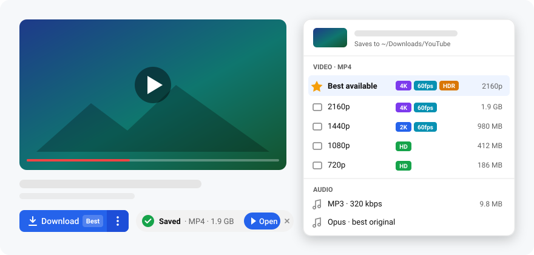
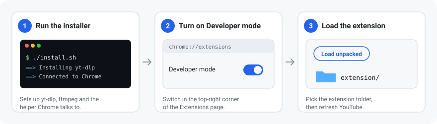
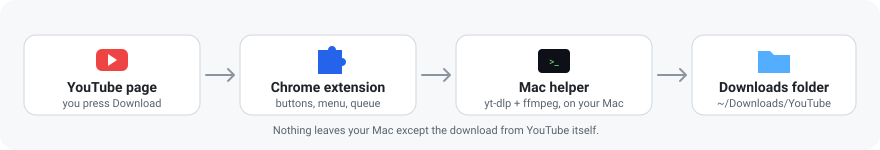

<div align="center">


# YT Downloader

**One-click YouTube downloads in Chrome, saved straight to your Mac.**
Free, private, no accounts, no limits.

[](https://github.com/MustafaB3irat/yt-downloader/tags)
[](LICENSE)
[](#requirements)
[](#install)
[](https://github.com/yt-dlp/yt-dlp)
[](https://www.python.org)



</div>

## Features

- **Download button** under every video and Short, matching YouTube's own buttons.
- **Every quality**: up to 8K, 60fps and HDR, with file sizes. Best quality by default.
- **Audio**: MP3 up to 320 kbps, or the original M4A / Opus stream.
- **Extras**: subtitles (.srt), thumbnails and whole playlists.
- **Remembers your pick**: the button shows your last choice (e.g. *Download · 1080p*).
- **Live progress** on the button, plus Open / Show in Finder when it's done.
- **Also works from** the toolbar popup, the right-click menu on any YouTube link, and keyboard shortcuts.
- **Private**: runs entirely on your Mac. No servers, no tracking, no sign-up.

## Requirements

- macOS with [Homebrew](https://brew.sh)
- Google Chrome (or Brave, Edge, Arc, Vivaldi, Chromium)

## Install



**1. Download and run the installer**

```bash
git clone https://github.com/MustafaB3irat/yt-downloader.git
cd yt-downloader
./install.sh
```

It installs yt-dlp, ffmpeg and deno, and connects the helper to Chrome. Keep the folder where it is; Chrome runs the helper from it.

**2. Turn on Developer mode**

Open `chrome://extensions` and switch on **Developer mode** (top-right).

**3. Load the extension**

Click **Load unpacked**, pick the `extension` folder inside `yt-downloader`, then refresh any open YouTube tab.

## Usage

| Want to | Do this |
|---|---|
| Download in your usual quality | Click **Download** |
| Pick a quality, MP3, subtitles… | Click **⋮** next to Download |
| Download a Short | Click the round download button. Right-click it for MP3 |
| Download from a link | Right-click any YouTube link → **YT Downloader** |
| Use the keyboard | **⌥⇧D** video · **⌥⇧A** MP3 |
| See the queue or change settings | Click the toolbar icon |

Files go to `~/Downloads/YouTube`. Change it in the popup under **Settings**.

## Quality

- **Best available** takes the highest resolution, then frame rate, then HDR.
- Video and audio are saved exactly as YouTube serves them, never re-encoded. Only MP3 is converted.
- **Prefer H.264** (on by default) picks QuickTime-friendly files only when they match the best quality. Above 1080p YouTube serves VP9/AV1; play those in IINA, VLC or Chrome.

## How it works



The extension adds the buttons. A small helper on your Mac does the download with [yt-dlp](https://github.com/yt-dlp/yt-dlp) and ffmpeg. It only runs while something is downloading.

When YouTube changes something, yt-dlp usually ships a fix within a day. The helper updates yt-dlp daily and again right after any failed download, then retries on its own.

## Update

```bash
cd yt-downloader
git pull
./install.sh
```

Then click ↻ on **YT Downloader** in `chrome://extensions`.

## Troubleshooting

```bash
scripts/doctor.sh
```

Checks every part and runs a live test. Most problems are fixed by running `./install.sh` again.

| Problem | Fix |
|---|---|
| "Mac helper not connected" | Run `./install.sh`, then reload the extension |
| No button on the page | Refresh the tab. Use the toolbar popup meanwhile |
| Age-restricted or members-only video | Turn on **Use my Chrome login** in Settings |
| Video won't play in QuickTime | It's VP9/AV1 (above 1080p). Use IINA or VLC |

Logs: `~/Library/Application Support/YTDownloader/logs/`

## Uninstall

```bash
./uninstall.sh
```

Then remove the extension in `chrome://extensions`. Your downloads stay.

## License

[MIT](LICENSE). Download only what you have the right to, and respect creators and YouTube's Terms of Service.
